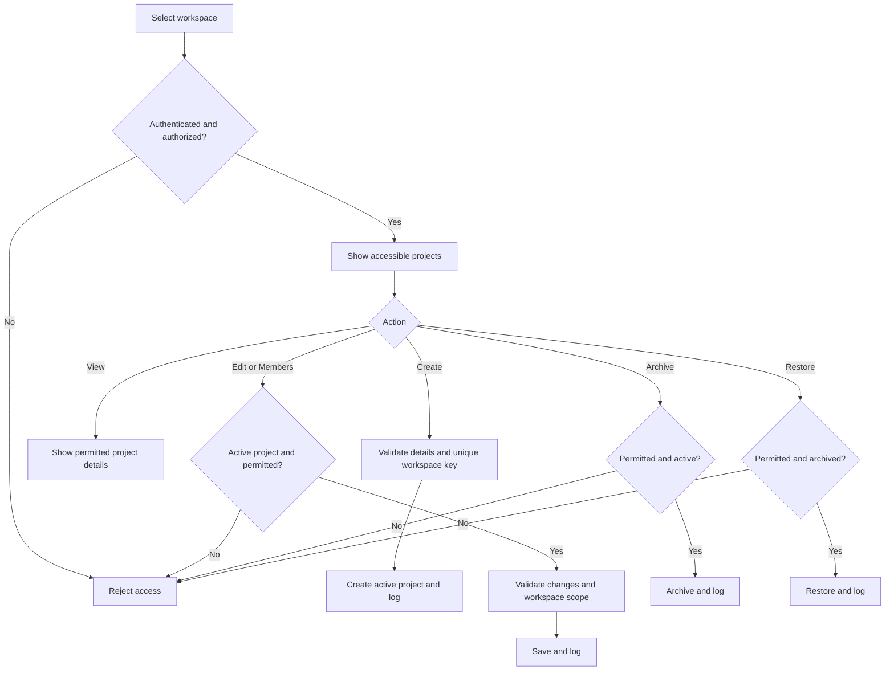

# Project Management

**Status:** Implemented and verified with Laravel feature tests and Chromium workflows.
**Dependencies:** P01 User & Access Management (accounts, workspaces, roles, permissions, activity logs).  
**Scope:** Workspace projects, project members, authorization, archiving, and restoration.

## 1. Purpose

Allow authorized users to create and administer projects within a workspace. Members work only in projects they are assigned to. Reuse P01's roles and permission mapping; do not create a separate project-role system.

## 2. Core Processes

### Create project
1. Authorized user selects a workspace and opens **Create Project**.
2. Enter **name**, **project key**, and optional **description**.
3. Laravel validates `projects.create`, workspace access, field values, and key uniqueness within that workspace.
4. Save the project as **active**, record its creator, and log the action.
5. Redirect to the new project's details.

### View and search projects
- **System Admin:** May access all workspaces and their projects.
- **Manager:** May view projects in their authorized workspace, subject to granted permission.
- **Member:** May view only assigned projects if granted `projects.view`.
- **Custom roles:** Follow their granted permissions plus applicable workspace/project scope.
- Provide search, status filter, and server-side pagination. Never return inaccessible projects in lists, counts, or select options.

### Edit project
1. Authorized user opens an **active** project.
2. Update name or description; keep project key immutable after creation.
3. Revalidate permission and workspace scope; persist changes and log meaningful edits.

### Manage project members
1. Authorized user opens **Project Members** for an active project.
2. Choose from **active members of the same workspace**.
3. Add or remove membership, rejecting duplicates and invalid users.
4. Save the change and log the actor/action. Access changes take effect on subsequent requests.

### Archive and restore
1. Authorized user archives an active project with confirmation.
2. Archived projects remain visible to authorized users but are **read-only**. Membership and history remain intact.
3. Authorized user may restore an archived project to active status.
4. **No permanent project deletion in P02.**

## 3. Flowchart

## 4. Permissions and Access

Use P01's `User::hasWorkspacePermission(Workspace, string)` (or its verified equivalent) with Laravel Policies and scoped queries. Register `projects` in the configurable role-permission matrix.

| Key | Meaning |
| --- | --- |
| `projects.view` | List and view permitted projects |
| `projects.create` | Create projects in the authorized workspace |
| `projects.edit` | Update active project details |
| `projects.delete` | Archive an active project (not hard-delete) |
| `projects.setup` | Manage project members and restore archived projects |

**Default access:** System Admin has global access; Manager can manage projects in their workspace under granted permissions; Member can view assigned projects by default. Custom workspace roles use their configured permission keys. Possessing `projects.view` does **not** bypass project membership for Members or equivalent restricted roles. No project-specific roles in P02.

Permissions and workspace ownership must be validated in Laravel for every route, update, member change, and search. Managers cannot obtain System Admin authority through project permissions.

## 5. Database Schema

### `projects`

| Column | Type / rule |
| --- | --- |
| `id` | Primary key |
| `workspace_id` | FK → `workspaces.id`, required |
| `name` | String, required |
| `key` | Uppercase alphanumeric string, required; stable after creation |
| `description` | Text, nullable |
| `status` | `active` / `archived`, default `active` |
| `created_by` | FK → `users.id` |
| `created_at`, `updated_at` | Timestamps |

**Constraints:** Unique (`workspace_id`, `key`); index (`workspace_id`, `status`). Project keys may repeat in different workspaces.

### `project_members`

| Column | Type / rule |
| --- | --- |
| `id` | Primary key |
| `project_id` | FK → `projects.id`, required |
| `user_id` | FK → `users.id`, required |
| `created_at`, `updated_at` | Timestamps |

**Constraints:** Unique (`project_id`, `user_id`). Membership is valid only when the user is an active member of the project's workspace; enforce this in Laravel. **Do not add `role_id`**: project permissions come from P01's workspace roles and project membership.

**P03 integration:** Projects also hold last_ticket_number, board_version and workflow_version. Creating a project initializes its default statuses and transitions in the same transaction; existing projects are backfilled by the forward P03 migration. Ticket/board links appear only when authorized. Ticket-only readers enter their scoped boards from the workspace. See ticket-management.md for the complete ticket/workflow blueprint.

**Reuse:** `users`, `workspaces`, `workspace_members`, `roles`, and `activity_logs`. No duplicate audit or permissions tables.

## 6. Validations and Business Rules

- Require authenticated, active users with authorized workspace access.
- Name and key are required; trim input and normalize the key to uppercase alphanumeric characters (e.g. `HRIS`). Enforce uniqueness **per workspace**.
- Derive workspace ownership and creator server-side; do not trust protected IDs, permissions, or status supplied by the frontend.
- Project key cannot change after creation.
- Users added to a project must have active membership in **that project's workspace**. Reject foreign-workspace IDs and duplicate assignments.
- Every project query, route, count, and member selector must respect workspace and project visibility.
- Archived projects may be viewed but not edited or have members changed until restored.
- Archive/restore and member updates require explicit authorization; archive is not permanent deletion.
- Use database transactions for coordinated writes and audit history; preserve existing data and migration history.
- Log significant project creation, edits, membership changes, archive, and restore events using P01's activity mechanism.

## 7. Pages and UI

| Screen | Content |
| --- | --- |
| Project List | Search, status filter, paginated accessible projects, create action if permitted |
| Project Details | Project information, status, members |
| Project Form | Create/edit fields with validation and loading states |
| Project Members | Add/remove eligible workspace members |
| Project Settings | Authorized edit, archive, and restore actions |

Use Vue 3 + Inertia forms, typed props, shadcn-vue, and feature-first components. Prefer dialogs for small forms. Hide unauthorized actions; keep archived projects visibly read-only. Backend remains the source of truth.

## 8. Verification

Laravel feature tests cover create/edit, normalization and workspace-scoped key uniqueness, protected fields, independent permissions/custom roles, Manager scope escalation, scoped list/activity counts, same-workspace member choices, bounded member search, duplicate prevention, archive/restore, suspension, workspace removal/rejoin, and denied cross-workspace requests. Upgrade tests verify default grants and preserved references. Factories create valid relationships; optional demo seeding is repeatable and preserves existing accounts and edited/archived projects. Chromium exercises create/edit, member assignment, a separate Member session, archive/read-only behavior, restore, removal/access revocation, and project search. The complete backend suite passes 53 tests / 648 assertions; all seven browser workflows pass.

## 9. Implementation Contracts

- System Admin has global scope. Only the protected workspace Manager role (`is_system = true`, `code = manager`) bypasses project membership. Custom roles, regardless of their names or grants, remain project-scoped.
- Custom roles cannot assign or invite the protected Manager role, even when they hold every registered permission; only protected Managers and System Admins can grant its broader scope.
- A workspace member creating a project is automatically added as a project member, with an audit record. A System Admin without workspace membership is not added.
- Viewing requires projects.view; create/edit/archive/setup permissions do not implicitly grant view. A creator without view returns to the workspace after creation.
- Use name up to 255 characters, key 2–10 uppercase letters/digits starting with a letter, and description up to 10,000 characters. Trim text and uppercase the key; reject punctuation rather than silently changing it.
- Laravel supplies statusOptions, fieldLabels, fieldStates, defaults, validationRules, and allowed actions as module-specific typed page props. Form components render explicit fields. Update metadata makes the key read-only.
- Member options use { value, label }, contain only active same-workspace users not already assigned, and are limited to 50 matches. A member_search filter supports authorized Inertia partial reloads. Actual members are paginated separately.
- Lock the workspace before project mutations, reload/lock the project, then recheck authorization/state. Workspace membership removal also removes project memberships in that workspace, preventing access from returning automatically after rejoining.
- Suspended accounts cannot use project routes or appear as selectable members; existing project membership rows stay intact.
- Routes live under /workspaces/{workspace}/projects. GET index/show, POST create, PATCH details, POST archive/restore, POST members, DELETE members/{member}. There is no project DELETE endpoint.
- Workspace activity hides project-subject events unless the viewer also has projects.view and can access that project; activity counts follow the same filter.
- All project mutations and their activity records commit together. Activity uses project.created, project.updated (before/after meaningful fields), project.archived, project.restored, project.member_added, and project.member_removed.
- Add forward migrations for projects/project_members and the default project grants: Manager receives all five grants, Member receives projects.view; custom roles retain existing grants. New workspace defaults follow the same rule.

## 10. Out of Scope

Ticket, Kanban and configurable workflow behavior belongs to the approved P03 blueprint in ticket-management.md. Sprints, project-specific roles, reporting, integrations and automation remain outside P02 and require separate approval.

**Documentation rule:** Keep `docs/modules/project-management.md` as the single complete, current P02 blueprint. Integrate approved revisions directly into the relevant sections; after implementation, reconcile documentation with verified code rather than appending patch notes.
