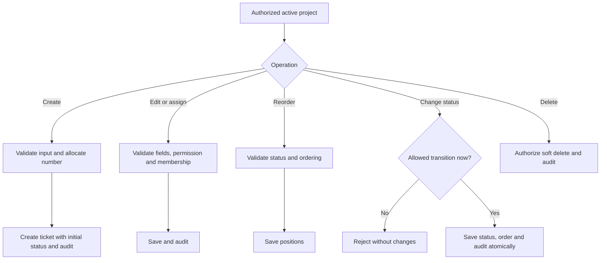
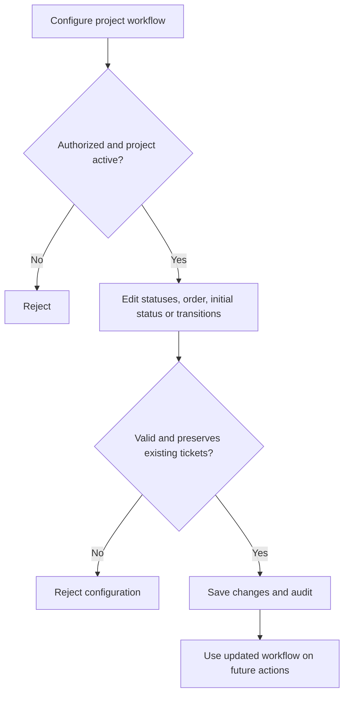

# Ticket, Kanban & Workflow Management

**Status:** Implemented and verified with Laravel feature tests, TypeScript checks, a production build, and Chromium workflows.
**Dependencies:** P01 User & Access Management; P02 Project Management  
**Goal:** Manage project tickets, board ordering, and configurable status transitions in one module.  

## 1. Scope

- **Tickets:** Create, view, update, assign, filter, and soft-delete within authorized projects.
- **Kanban:** Group tickets by status; reorder within a status; move across statuses through authorized transitions.
- **Workflows:** Each project has one configurable set of statuses and allowed transitions.
- **Audit:** Record significant ticket and workflow changes using the existing activity log.
- **Excluded:** Sprints, epics, subtasks, comments, attachments, notifications, approvals, and automation.

**Core rule:** The board reads from tickets and their statuses. It does not store a separate copy of ticket data. Workflow status is authoritative; moving a card alone never changes state.

## 2. Core Processes

### A. Ticket creation and maintenance
1. An authorized user selects an active project and submits ticket details: title, description, type, priority, optional assignee, and due date.
2. Laravel checks project access and `tickets.create`, validates the input, atomically allocates a project-specific number, and assigns the project's initial status.
3. The system creates the ticket and logs its creation. The display key combines the project key and ticket number (e.g., `HRIS-101`).
4. Authorized users may view, edit, reassign, filter, and soft-delete tickets under their corresponding permissions.
5. Generic edits cannot change the project's identity, ticket number, reporter, or workflow status. Status changes use the transition process.

### B. Board ordering and status changes
1. Retrieve authorized project tickets, grouped by the project's ordered workflow statuses; support server-side filters and bounded loading.
2. Reordering within a status updates only the affected ticket positions.
3. Moving to another status requests a transition. Laravel verifies project state, `tickets.edit`, current status, target status, and an allowed `from → to` transition at save time.
4. Save the new status/order and activity history atomically. On invalid or stale requests, reject the change without partially updating data.
5. Any ticket operation or board action must follow the same backend permission and workflow rules.

### C. Workflow configuration
1. An authorized user with `tickets.setup` configures project statuses, their order, categories, initial status, and allowed transitions.
2. New projects receive the default workflow below.
3. Enforce unique status codes per project, exactly one initial status, and transitions between statuses belonging to that project.
4. Statuses in use cannot be deleted until affected tickets are moved appropriately. Renaming or reordering a status must preserve ticket assignments and history.
5. Save valid changes and audit the actor. Updated configuration applies to subsequent ticket actions.

### Default workflow

| Code | Name | Category | Allowed next statuses |
|---|---|---|---|
| `todo` | To Do | `open` (initial) | `in_progress` |
| `in_progress` | In Progress | `active` | `todo`, `in_review` |
| `in_review` | In Review | `active` | `in_progress`, `done` |
| `done` | Done | `done` | `todo` (reopen) |

Statuses and transitions are project-configurable; never hardcode them in Vue. Category is separate from the status name, enabling stable completion reporting.

## 3. Database Schema

### `tickets`

| Field | Rule |
|---|---|
| `id` | Primary key |
| `project_id` | FK → `projects.id` |
| `number` | Sequential within project; unique with `project_id` |
| `title` | Required |
| `description` | Nullable text |
| `type` | Initially `task`, `bug`, `story`; server-defined choices |
| `priority` | Initially `low`, `medium`, `high`, `urgent`; server-defined choices |
| `status_id` | FK → `project_statuses.id` |
| `sort_order` | Position within status |
| `version` | Unsigned integer, initially 1; rejects stale edits/moves/deletion |
| `reporter_id` | FK → `users.id`; set by server |
| `assignee_id` | Nullable FK → `users.id` |
| `due_date` | Nullable date |
| `created_at`, `updated_at`, `deleted_at` | Timestamps; soft deletion |

**Indexes / integrity:** Unique `(project_id, number)`; index `(project_id, status_id, sort_order)` and `(project_id, assignee_id)`. Enforce that selected status and assignee belong to the correct project scope.

### `project_statuses`

| Field | Rule |
|---|---|
| `id` | Primary key |
| `project_id` | FK → `projects.id` |
| `code` | Stable, unique within project |
| `name` | Human-readable label |
| `category` | `open`, `active`, `done` |
| `position` | Column/display order |
| `is_initial` | Exactly one per project |
| `created_at`, `updated_at` | Timestamps |

**Constraints:** Unique `(project_id, code)`; index `(project_id, position)`. Maintain the single-initial-status rule transactionally.

### `project_status_transitions`

| Field | Rule |
|---|---|
| `id` | Primary key |
| `project_id` | FK → `projects.id` |
| `from_status_id` | FK → `project_statuses.id` |
| `to_status_id` | FK → `project_statuses.id` |

**Constraints:** Unique `(project_id, from_status_id, to_status_id)`; reject self-transitions and cross-project status references.

### `projects` — additional field

- `last_ticket_number` — unsigned integer, default `0`; increment under a transaction/row lock.
- `board_version` — unsigned integer, default `0`; changes after ticket mutations or workflow changes; stale board moves are rejected.
- `workflow_version` — unsigned integer, default `0`; increments on workflow saves; stale configuration saves are rejected.
- Preserve stable project keys after tickets exist to avoid breaking references.

**Reuse P01/P02 data:** `users`, `workspaces`, `roles`, `workspace_members`, `projects`, `project_members`, and `activity_logs`. No separate Kanban table or workflow entity is needed while each project has a single workflow.

## 4. Permissions

Reuse P01 module-based RBAC, Laravel Policies/Gates, and P02 project membership.

| Key | Allows |
|---|---|
| `tickets.view` | View tickets and board in accessible projects |
| `tickets.create` | Create tickets |
| `tickets.edit` | Update/assign tickets, reorder, and request status transitions |
| `tickets.delete` | Soft-delete tickets |
| `tickets.setup` | Configure project statuses and transitions |

- **System Admin:** Full system access.
- **Manager:** Access within authorized workspace and granted permissions.
- **Member/custom role:** Granted permission **and** project membership required.
- Validate access on every query and mutation; permission keys alone never bypass project scope.

## 5. Validations and Business Rules

- Archived projects are read-only: reject ticket edits, moves, deletion, and workflow configuration.
- Assignees must be active, eligible members of the same project; reject external/removed users.
- Allocate ticket numbers atomically; do not use unprotected `MAX(number) + 1`.
- Server sets project, reporter, number, and initial status; guard these fields against unauthorized changes.
- Only configured transitions are valid; changing status through generic updates is prohibited.
- Changes to status, ordering, and related audit records should commit together; handle concurrent changes safely.
- Reject removing in-use statuses or transitions/configuration that invalidate required project workflow rules.
- Audit creation, important edits, assignment, deletion, transitions, and workflow setup changes.
- Use standard Laravel controllers, Form Requests, models, and policies; add a focused service only for coordinated multi-record operations.

## 6. Process Flowcharts

### Ticket operations and board moves

### Workflow configuration

## 7. Routes, data and activity

All project routes start with /workspaces/{workspace}/projects/{project}.

| Method and suffix | Behavior |
| --- | --- |
| GET /tickets | Authorized board/list/table, filters, pagination, optional ticket drawer |
| POST /tickets | Create using server-owned identity and initial status |
| PATCH /tickets/{ticket} | Update approved fields with the current ticket version |
| DELETE /tickets/{ticket} | Version-checked soft deletion |
| POST /tickets/{ticket}/move | Version-checked reorder/transition using target status and optional before_id |
| GET /workflow | Authorized configuration form |
| PUT /workflow | Atomically replace valid statuses/order/transitions with current workflow version |

Laravel owns choice lists, field labels, required/read-only states, defaults, validation metadata, selectable assignees, allowed actions, workflow statuses/transitions and versions. The frontend uses small typed Inertia props and explicit forms. Assignee search uses an authorized partial reload with a 50-match limit.

Ticket events are ticket.created, ticket.updated (before/after meaningful fields, including assignment), ticket.deleted, ticket.transitioned and ticket.reordered. Workflow setup logs workflow.updated against the project. All record changes and their logs commit together. The ticket drawer shows the latest 30 scoped ticket events with actor names and timestamps. Workspace activity filters ticket and workflow events by tickets.view and project visibility before pagination and counting.

## 8. Implementation contracts

- Routes are scoped under /workspaces/{workspace}/projects/{project}/tickets and /workflow. Ticket permissions are independent of projects.view, but always require the same project/workspace visibility. Default Manager receives all ticket grants; Member receives view/create/edit. Custom roles are unchanged. Ticket-only readers get paginated assigned-board links in the workspace.
- All mutations lock workspace then project, recheck actor permission and archived state, and commit data and audit together. Ticket numbers never reset after deletion. Project keys remain immutable. Ticket version, project board_version and workflow_version provide explicit stale-write detection; a rejected operation changes neither ordering nor audit.
- Board moves submit ticket version, expected source status, board version, target status and an optional before-ticket anchor. The server orders the complete target column, including cards hidden by filters/loading, and updates only changed positions. No anchor appends. Same-status reorders skip workflow transitions. Cross-status moves require a currently configured transition.
- Workflow saves replace the ordered status list and transition set transactionally (1–20 statuses). Stable codes identify existing statuses; rename only the display name. Exactly one initial status is required. Categories are open/active/done. Reject duplicate/self/cross-project transitions and removal of statuses referenced even by soft-deleted tickets. Concurrent workflow saves require the current workflow_version.
- Title is trimmed, required, max 255; description nullable max 10000; date YYYY-MM-DD; type and priority are server-defined. Assignees must be active verified same-workspace project members with tickets.view. Removed/suspended assignees stay in history but cannot be selected for a new assignment; unchanged historical assignment may be preserved on an unrelated edit.
- Laravel provides workTypes, priorities, status options, transitions, assignees, fieldLabels, fieldStates, defaults, validationRules, allowed actions and versions. Assignee search is authorized and capped at 50.
- Board/list load up to 30 tickets per status with explicit per-column next-page navigation, full filtered counts, and a next_id anchor beyond the loaded window. Table is paginated at 30 with allowlisted server-side sorting. Filters: search, status, priority, type and assignee. No separate board records.
- Ticket details use a query-selected right drawer preserving current filters, table page and scroll; title/description and properties are editable, with a separate authorized transition action. Creation is a centered dialog and always uses the configured initial status. Inline Add task appears only in that initial column. Table property edits use the same backend validation/version contract.
- Ticket views share the same authenticated shell and premium visual tokens as workspaces, accounts, project overview and profile.
- UI follows docs/UI-UX.md and its inspected screenshots: warm sidebar, white canvas, compact project header/tabs, muted board columns and semantic magenta primary actions. Smooth drag uses vue-draggable-plus with ~180ms movement, reduced-motion support, and rollback/error toast. Keyboard users can use status selection and move up/down actions without drag. Dialogs/drawers use focus-managed Reka/shadcn primitives. Failed submissions preserve entered values and inline errors; successful state-changing submissions show one confirmation toast.
- To avoid data leaks, workspace activity excludes ticket subjects unless tickets.view plus project scope permits them; project workflow events use the same check. Ticket history is scoped to the selected accessible ticket.
- Existing projects receive defaults through a forward migration; newly created projects, factories and demo seeders initialize the same default workflow. Optional repeatable demo tickets preserve edited existing records.

## 9. Verification and current limits

- Laravel feature coverage includes protected identity, sequential numbering, creation and audit, independent permissions, project/workspace isolation, ticket-only navigation, active/eligible assignment and bounded search, generic-edit status protection, soft deletion, archived read-only behavior, valid/invalid/stale moves, complete-column ordering, workflow rename/initial/transition validation, referenced-status protection, migration backfill and repeatable demo data.
- A separate MariaDB verification database exercised eight simultaneous ticket creations (unique numbers 1–8 and eight creation audits) and two competing moves (one saved, one stale rejection, one transition audit). The normal endgame2 schema received only the forward migration; no reset or destructive command ran.
- Frontend follows the inspected board/list/table/dialog/drawer references and the shared Geist/shadcn-vue visual system. Chromium verifies creation, editing, transitions, deletion, drag persistence, workflow configuration, stale-save input preservation, mobile width, dialog focus, and responsive navigation. Desktop, mobile and dark-theme screenshots were inspected.
- The complete backend suite passes 68 tests / 1112 assertions. All 13 browser workflows pass; TypeScript and the production build pass. Browser tests use dedicated SQLite fixtures and built assets independently of a running development Vite server.
