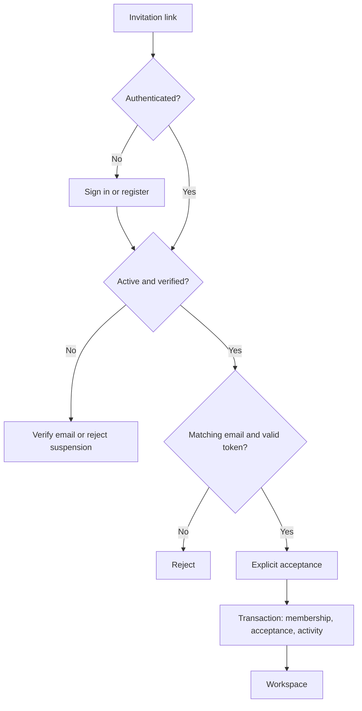
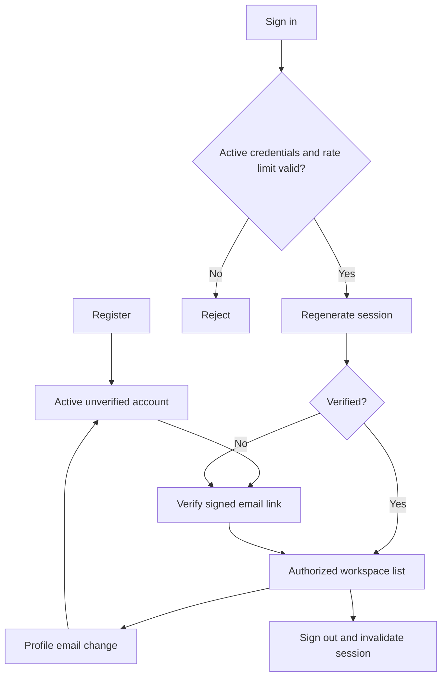
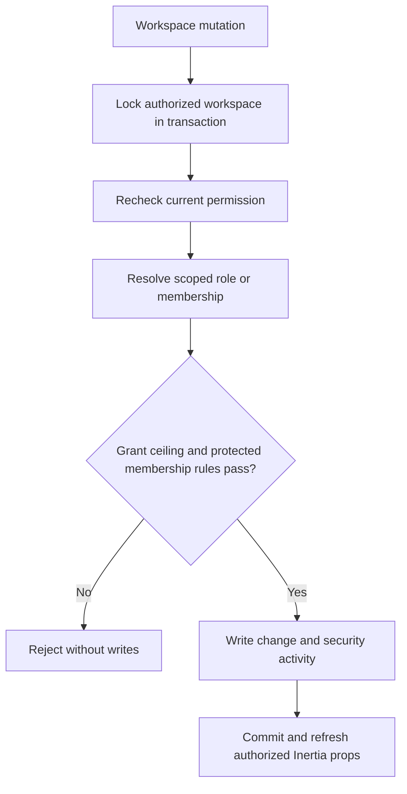

# User & Access Management

## Status
Phase 01, including Task 5 custom role codes and granular module permissions, is implemented and covered by backend and Chromium tests. Owns accounts, workspaces, invitations, memberships, roles and security activity. Project and ticket access integrate with the Project Management and Ticket, Kanban & Workflow Management modules.

## Accounts
Native Laravel sessions, password broker, email verification notifications and signed links. Register active, unverified, non-admin users. Normalize emails to lowercase. Passwords require confirmation and 12 characters. Limit login to five failures per minute per email/IP. Regenerate sessions on login and invalidate on logout. Profile email changes reset verification. Password changes require current password. Suspended accounts cannot authenticate or continue existing sessions. Only verified active System Admins administer global accounts. HTTP never grants System Admin. No self-suspension or suspension of another System Admin; no account deletion. An explicit console command provisions protected ownership.

## Workspaces and permissions
Only System Admins create/update workspaces and administer global accounts. System Admin remains a protected user flag, never a workspace role or assignable permission. Manager and Member are the two default workspace roles; both remain immutable and cannot be deleted. Users may hold different workspace roles in different workspaces. Ordinary members require workspace membership; all checks require an active, verified account.

### Central module registry
The supported modules and actions live in config/access.php. Only implemented workspace modules are registered. Project permissions are registered for P02 and ticket/workflow permissions for P03. Personal profile, workspace listing and global account/workspace administration retain their existing access boundaries.

| Module | View | Create | Edit | Delete | Setup |
| --- | --- | --- | --- | --- | --- |
| Workspace members | members.view: list members | members.create: invite/cancel invitations | members.edit: change member roles | members.delete: remove members | Not applicable |
| Roles & permissions | roles.view: list roles and grants | roles.create: create custom roles | roles.edit: change name/code | roles.delete: delete unreferenced custom roles | roles.setup: change grants |
| Projects | projects.view: view scoped projects | projects.create: create projects | projects.edit: edit active projects | projects.delete: archive projects | projects.setup: members and restore |
| Tickets & workflow | tickets.view: view tickets and board | tickets.create: create tickets | tickets.edit: edit, assign and move tickets | tickets.delete: delete tickets | tickets.setup: configure project workflow |
| Activity log | activity.view: read workspace history | Not applicable | Not applicable | Not applicable | Not applicable |

Store enabled resource.action keys as a JSON array in roles.permissions. No separate permission tables or packages. Manager receives all supported workspace keys; Member receives projects.view and tickets.view/create/edit for assigned projects. Actions are independently authorized; grant View as well when a user needs the corresponding list in the UI. New modules register supported actions when implemented.

### Custom role rules
A custom role has a required name (max 100), a required lowercase kebab-case code (max 100, starts with a letter), and an explicit array of supported permission keys. Names and codes are unique within a workspace. Normalize codes to lowercase and trim names/codes. System Admin name/code is reserved. Reject client-provided workspace_id, is_system and is_system_admin fields. Default role codes are manager and member.

Create requires roles.create; creating nonempty grants additionally requires roles.setup. Updates require roles.edit for changed name/code and roles.setup for changed grants. Delete requires roles.delete. Both existing and proposed grants must stay within the actor’s own grants; actors cannot alter, assign or delete more powerful roles. Protected Manager additionally grants workspace-wide project scope: only another protected Manager or System Admin may assign/invite that role. Custom roles cannot grant it even if all permission keys match. Role selector options and backend member/invitation checks use the same assignment rule. Default roles remain immutable. Roles referenced by any membership or invitation cannot be deleted. An empty permission array is valid. The matrix displays modules as rows and View/Create/Edit/Delete/Setup as columns; unsupported actions are marked not applicable and unauthorized grant controls are hidden. Protected defaults can be inspected in a read-only matrix. Server-computed action flags and matrix cells control UI visibility; Laravel rechecks every mutation under the workspace lock. Changes apply on the next request, without login renewal or cached role grants.

### Membership and audit
Managers cannot change their own membership, modify System Admin memberships, or remove/demote the last active Manager. Removing a membership preserves the global account and removes that user’s project memberships in the workspace, recording each removal. Rejoining the workspace does not restore project assignments. Serialize coordinated writes with workspace row locks and atomically record role creation, deletion, and before/after name/code/grant changes. Role and member lists, invitations and activity each require their specific viewing capability. Audit history remains immutable. Project-subject events and their counts are filtered by projects.view and project visibility, including in workspace history.

### Safe upgrade
A forward migration adds unique workspace-scoped role codes and backfills deterministic collision-safe codes without changing IDs, membership or invitation references. Legacy members.invite/update/remove grants become members.create/edit/delete. Legacy roles.manage expands to roles.view/create/edit/delete/setup. Legacy members.view also receives activity.view, preserving its former history access. Existing names, system flags, user privileges and records are preserved. Unknown stored keys remain ungrantable until explicitly supported by the registry. The project forward migration extends only protected Manager/Member defaults with their P02 grants and preserves custom grants, references and user flags. No database reset is permitted.

## Invitations
Authorized inviters choose an assignable scoped role. Reject existing members and duplicate pending invitations. Generate 64-character random tokens; persist only SHA-256 hashes. Expire after seven days. Send Laravel Notification after commit. A failed delivery leaves a cancellable invitation. Authorized inviters may cancel outstanding invitations and invite again. Never return tokens in lists or logs. Invitation cancellation actions are shown only for roles the actor can assign.

Recipients sign in/register, verify their matching email, then accept explicitly via POST. Preserve the intended URL through authentication/verification. Acceptance locks workspace and invitation; validates token/email/expiry/cancellation; creates membership, marks acceptance and writes activity atomically. Repeat acceptance succeeds without duplication; it cannot restore removed membership. Existing membership is preserved. Reject invalid, mismatched, expired or cancelled links.

## Flow

## Schema and relationships
Use forward migrations preserving existing data. IDs are bigint.

| Table | Fields and constraints |
| --- | --- |
| users | Existing fields plus status active/suspended default active; is_system_admin boolean default false |
| workspaces | name, unique slug varchar(100), timestamps |
| roles | workspace_id FK cascade, name/code varchar(100), permissions JSON, is_system boolean, timestamps; unique(workspace_id,name), unique(workspace_id,code), unique(workspace_id,id) |
| workspace_members | workspace_id FK cascade, user_id FK cascade, role_id scoped composite FK restrict, timestamps; unique(workspace_id,user_id) |
| workspace_invitations | workspace_id FK cascade, email indexed, role_id scoped composite FK restrict, token_hash char(64) unique, expires_at, accepted_at/cancelled_at nullable, invited_by FK restrict, timestamps |
| activity_logs | workspace_id/actor_id nullable FKs null on delete, action, subject_type, subject_id nullable bigint, changes nullable JSON, created_at; workspace/created_at index |

Users have memberships; workspaces have roles, members, invitations and logs. Invitations belong to a role and inviter. Composite role FKs prevent cross-workspace assignments. Audit data is allowlisted and excludes secrets. Log account lifecycle, authentication, profile/password changes, workspace changes, invitation lifecycle, membership/role changes and account administration. Workspace history requires activity.view; admins see recent global activity. Logs are read-only and paginated.

## UI and verification
All account, workspace, membership, role, invitation and activity screens share the responsive premium navigation shell, compact typography, semantic tokens, form controls and dialogs defined in docs/UI-UX.md. Authentication and recovery use the same visual system in a focused branded layout. Module permissions and existing submission behavior stay unchanged.

The root URL redirects guests to sign-in and authenticated users to workspaces. Explicit typed Inertia forms and kebab-case Vue pages. Contextual dialogs for short forms. Display errors, pending state and success feedback; hide actions using server-computed capabilities. Paginate lists. Confirm membership removal. Laravel remains authoritative.

Test authentication, suspended sessions, tenant isolation, escalation, invitation edge cases and transactional activity. Playwright exercises auth and invitation/membership workflows on an isolated database. Factories provide valid relationships. Optional demo seeding is repeatable and preserves credentials. Browser setup verifies its dedicated SQLite target before migrations or fixtures, starts PHP directly, and stops its own server after tests. No production database reset is authorized.

## Routes and process boundaries

| Area | Routes | Access |
| --- | --- | --- |
| Authentication | GET/POST /login, /register; POST /logout | Guest forms; authenticated logout |
| Recovery | GET/POST /forgot-password; GET /reset-password/{token}; POST /reset-password | Guest; throttled submissions |
| Verification | GET /email/verify; signed GET /email/verify/{id}/{hash}; POST /email/verification-notification | Active authenticated account; matching signed verification link |
| Profile | GET/PATCH /profile; PUT /profile/password | Active authenticated account, including unverified users |
| Workspaces | GET/POST /workspaces; GET/PATCH /workspaces/{workspace} | Active verified account; create/update admin only, detail scoped |
| Roles | POST /workspaces/{workspace}/roles; PATCH/DELETE /workspaces/{workspace}/roles/{role} | Action-specific roles.create/edit/delete/setup plus grant ceiling and system-role protection |
| Members | PATCH/DELETE /workspaces/{workspace}/members/{member} | members.edit/delete plus member and Manager protections |
| Invitations | POST /workspaces/{workspace}/invitations; DELETE /workspaces/{workspace}/invitations/{invitation} | members.create plus assignable role |
| Acceptance | GET/POST /invitations/{invitation}/{token} | Active verified recipient with matching email and valid token |
| Global accounts | GET /admin/users; PATCH /admin/users/{user} | System Admin; only active/suspended status is mutable |

## Provisioning and deployment
The checkout uses the separate endgame2 development database configured in the ignored .env file. Forward migrations preserve existing data; no database reset is authorized. Provision an administrator with php artisan app:make-admin email@example.com --name="Name"; new account passwords are prompted privately. Configure Laravel mail before using verification, recovery or invitation emails. In local/testing, default seeding calls DemoDatabaseSeeder: five users, five workspaces, five roles/members/invitations per workspace, and activity. DemoProjectSeeder adds five projects per demo workspace with valid memberships only when the project is first created. Reruns preserve existing credentials, account status/admin flags, role grants, project edits/status and existing relationships. Production default seeding creates no demo data.
