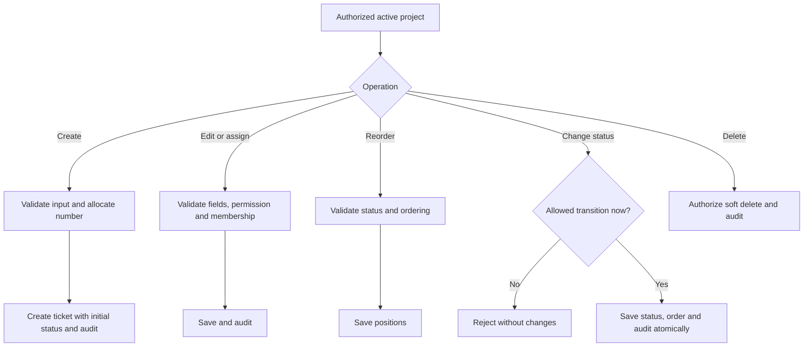
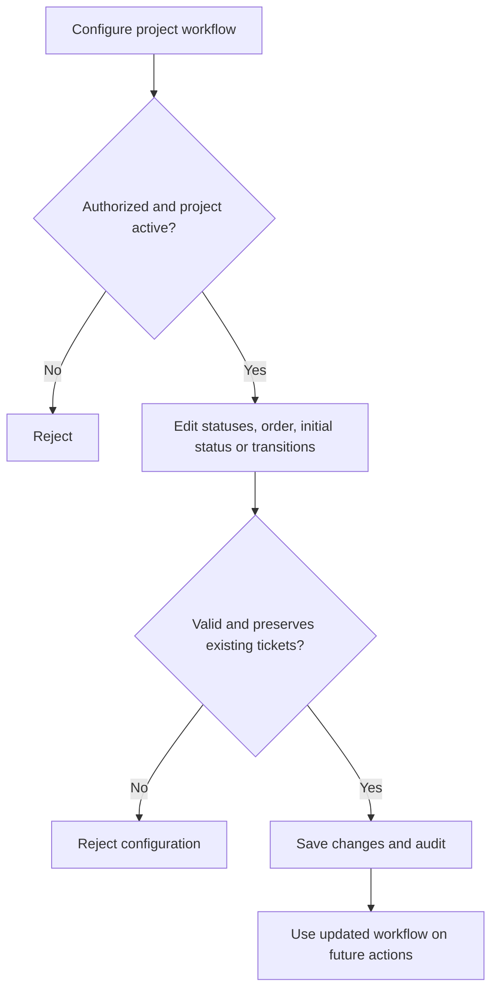

# Phase 03 — Ticket, Kanban & Workflow Management

**Status:** Approved for implementation — backend verified; frontend verification in progress  
**Dependencies:** P01 User & Access Management; P02 Project Management  
**Goal:** Manage project tickets, board ordering, and configurable status transitions in one module.  
**Final module blueprint:** `docs/modules/ticket-management.md`

## 1. Scope

- **Tickets:** Create, view, update, assign, filter, and soft-delete within authorized projects.
- **Kanban:** Group tickets by status; reorder within a status; move across statuses through authorized transitions.
- **Workflows:** Each project has one configurable set of statuses and allowed transitions.
- **Audit:** Record significant ticket and workflow changes using the existing activity log.
- **Excluded:** Sprints, epics, subtasks, comments, attachments, notifications, approvals, and automation.

**Core rule:** The board reads from tickets and their statuses. It does not store a separate copy of ticket data. Workflow status is authoritative; moving a card alone never changes state.

## 2. Core Processes

### A. Ticket creation and maintenance
1. An authorized user selects an active project and submits ticket details: title, description, type, priority, optional assignee, and due date.
2. Laravel checks project access and `tickets.create`, validates the input, atomically allocates a project-specific number, and assigns the project's initial status.
3. The system creates the ticket and logs its creation. The display key combines the project key and ticket number (e.g., `HRIS-101`).
4. Authorized users may view, edit, reassign, filter, and soft-delete tickets under their corresponding permissions.
5. Generic edits cannot change the project's identity, ticket number, reporter, or workflow status. Status changes use the transition process.

### B. Board ordering and status changes
1. Retrieve authorized project tickets, grouped by the project's ordered workflow statuses; support server-side filters and bounded loading.
2. Reordering within a status updates only the affected ticket positions.
3. Moving to another status requests a transition. Laravel verifies project state, `tickets.edit`, current status, target status, and an allowed `from → to` transition at save time.
4. Save the new status/order and activity history atomically. On invalid or stale requests, reject the change without partially updating data.
5. Any ticket operation or board action must follow the same backend permission and workflow rules.

### C. Workflow configuration
1. An authorized user with `tickets.setup` configures project statuses, their order, categories, initial status, and allowed transitions.
2. New projects receive the default workflow below.
3. Enforce unique status codes per project, exactly one initial status, and transitions between statuses belonging to that project.
4. Statuses in use cannot be deleted until affected tickets are moved appropriately. Renaming or reordering a status must preserve ticket assignments and history.
5. Save valid changes and audit the actor. Updated configuration applies to subsequent ticket actions.

### Default workflow

| Code | Name | Category | Allowed next statuses |
|---|---|---|---|
| `todo` | To Do | `open` (initial) | `in_progress` |
| `in_progress` | In Progress | `active` | `todo`, `in_review` |
| `in_review` | In Review | `active` | `in_progress`, `done` |
| `done` | Done | `done` | `todo` (reopen) |

Statuses and transitions are project-configurable; never hardcode them in Vue. Category is separate from the status name, enabling stable completion reporting.

## 3. Database Schema

### `tickets`

| Field | Rule |
|---|---|
| `id` | Primary key |
| `project_id` | FK → `projects.id` |
| `number` | Sequential within project; unique with `project_id` |
| `title` | Required |
| `description` | Nullable text |
| `type` | Initially `task`, `bug`, `story`; server-defined choices |
| `priority` | Initially `low`, `medium`, `high`, `urgent`; server-defined choices |
| `status_id` | FK → `project_statuses.id` |
| `sort_order` | Position within status |
| `reporter_id` | FK → `users.id`; set by server |
| `assignee_id` | Nullable FK → `users.id` |
| `due_date` | Nullable date |
| `created_at`, `updated_at`, `deleted_at` | Timestamps; soft deletion |

**Indexes / integrity:** Unique `(project_id, number)`; index `(project_id, status_id, sort_order)` and `(project_id, assignee_id)`. Enforce that selected status and assignee belong to the correct project scope.

### `project_statuses`

| Field | Rule |
|---|---|
| `id` | Primary key |
| `project_id` | FK → `projects.id` |
| `code` | Stable, unique within project |
| `name` | Human-readable label |
| `category` | `open`, `active`, `done` |
| `position` | Column/display order |
| `is_initial` | Exactly one per project |
| `created_at`, `updated_at` | Timestamps |

**Constraints:** Unique `(project_id, code)`; index `(project_id, position)`. Maintain the single-initial-status rule transactionally.

### `project_status_transitions`

| Field | Rule |
|---|---|
| `id` | Primary key |
| `project_id` | FK → `projects.id` |
| `from_status_id` | FK → `project_statuses.id` |
| `to_status_id` | FK → `project_statuses.id` |

**Constraints:** Unique `(project_id, from_status_id, to_status_id)`; reject self-transitions and cross-project status references.

### `projects` — additional field

- `last_ticket_number` — unsigned integer, default `0`; increment under a transaction/row lock.
- Preserve stable project keys after tickets exist to avoid breaking references.

**Reuse P01/P02 data:** `users`, `workspaces`, `roles`, `workspace_members`, `projects`, `project_members`, and `activity_logs`. No separate Kanban table or workflow entity is needed while each project has a single workflow.

## 4. Permissions

Reuse P01 module-based RBAC, Laravel Policies/Gates, and P02 project membership.

| Key | Allows |
|---|---|
| `tickets.view` | View tickets and board in accessible projects |
| `tickets.create` | Create tickets |
| `tickets.edit` | Update/assign tickets, reorder, and request status transitions |
| `tickets.delete` | Soft-delete tickets |
| `tickets.setup` | Configure project statuses and transitions |

- **System Admin:** Full system access.
- **Manager:** Access within authorized workspace and granted permissions.
- **Member/custom role:** Granted permission **and** project membership required.
- Validate access on every query and mutation; permission keys alone never bypass project scope.

## 5. Validations and Business Rules

- Archived projects are read-only: reject ticket edits, moves, deletion, and workflow configuration.
- Assignees must be active, eligible members of the same project; reject external/removed users.
- Allocate ticket numbers atomically; do not use unprotected `MAX(number) + 1`.
- Server sets project, reporter, number, and initial status; guard these fields against unauthorized changes.
- Only configured transitions are valid; changing status through generic updates is prohibited.
- Changes to status, ordering, and related audit records should commit together; handle concurrent changes safely.
- Reject removing in-use statuses or transitions/configuration that invalidate required project workflow rules.
- Audit creation, important edits, assignment, deletion, transitions, and workflow setup changes.
- Use standard Laravel controllers, Form Requests, models, and policies; add a focused service only for coordinated multi-record operations.

## 6. Process Flowcharts

### Ticket operations and board moves

### Workflow configuration

## 7. Verification and Documentation

Verify authorization, workspace/project isolation, ticket numbering under concurrency, eligible assignments, soft deletion, status ownership, valid/invalid transitions, ordering, archive restrictions, and workflow changes. Use Laravel feature tests and Playwright for critical end-to-end flows.

After implementation, reconcile `docs/modules/ticket-management.md` with the actual system: complete current processes, schema, permissions, validations, and diagrams—not patch notes. Update `docs/SDD.md` to reflect that Kanban and Workflow Management are included in **P03**, rather than a separate P04.
